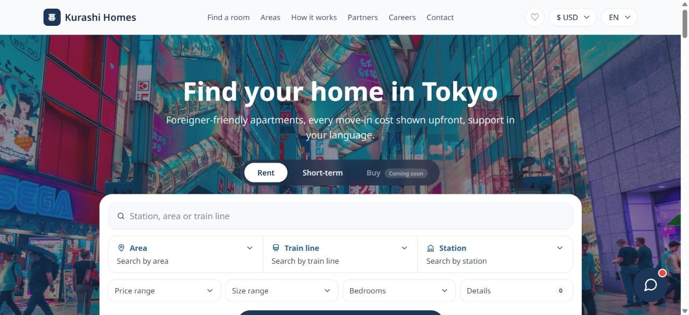
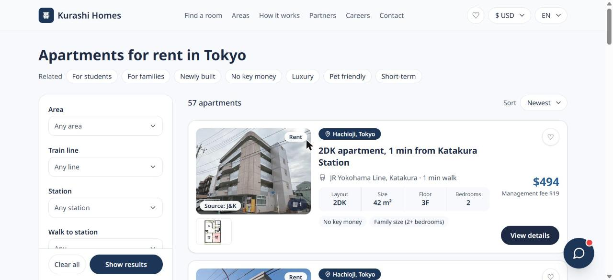
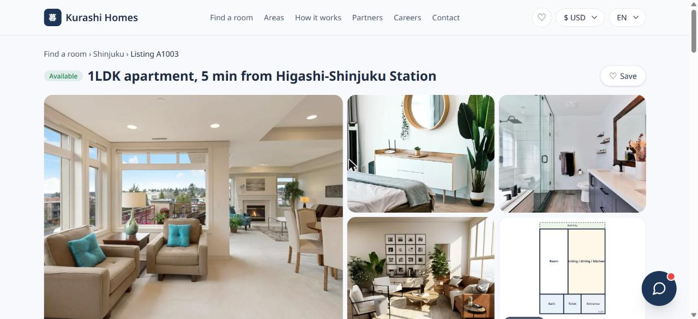
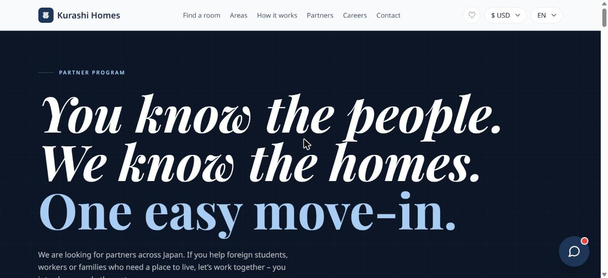

# Kurashi Homes – Tokyo rentals for foreign residents

A multilingual rental‑apartment website for foreigners living in Japan: search by area, train line and station, see every move‑in cost before applying, and get help in **English, Burmese and Japanese**.

**Live demo → [a-realty-website.vercel.app](https://a-realty-website.vercel.app)**

> Freelance project (2026). This repository is the working demo built for a Tokyo rental agency before the production build. “Kurashi Homes” is a placeholder brand; listings are sample data plus a small set of real vacant rooms imported from public listing sites.

| Home | Search |
|---|---|
|  |  |
| **Listing** | **Partner program** |
|  |  |

## Features

**Search**
- Hero search with quick‑search suggestions (stations, areas, lines), area / train line / station pickers and price, size and bedroom ranges
- Filter sidebar (drawer on phones): walk time, rent, size, layout, building age and contract conditions (no guarantor, no key money, pets, furnished, short‑term…)
- Filters live in the URL, so every search is shareable and indexable; rented rooms drop out of results automatically

**Listings**
- Photo gallery with a full‑screen viewer (keyboard and swipe), floor plan drawn from the layout code (1R…3LDK)
- Monthly total and an itemised **initial‑cost breakdown** (deposit, key money, brokerage, guarantor, insurance…) with live totals
- Amenities, map, similar listings, availability status

**For visitors**
- Three languages with per‑language URLs; currency switcher (JPY / USD / EUR / VND, USD by default in English)
- Favourites saved on the device, no sign‑up
- Floating contact widget: LINE, WhatsApp, Messenger and phone, with a chat window that hands the conversation over to the chosen app

**Company pages**
- Partner / collaborator program with application form
- Careers: open positions, job pages with Google for Jobs structured data, application form with CV upload (PDF/Word, size‑checked)

**Quality**
- Mobile‑first and checked at 390 px in all three languages; iOS details handled (no input zoom, keyboard‑aware chat, no sideways scroll)
- Accessible custom dropdowns (keyboard navigation, ARIA listbox) and form error messages
- SEO: canonical + hreflang for every page, per‑page titles and descriptions, JobPosting JSON‑LD, staging deployments are `noindex`

## Tech stack

| | |
|---|---|
| Framework | Next.js 16 (App Router, static generation), React 19, TypeScript (strict) |
| Styling | Tailwind CSS 4 with design tokens |
| i18n | next‑intl 4 – English, Burmese (Unicode), Japanese |
| Validation | Zod |
| Testing | Vitest – 119 tests across filters, costs, currency, forms, i18n parity and data |
| Hosting | Vercel (auto‑deploy from `master`) |

## Architecture notes

- **Data‑access layer** (`src/lib/data`): pages never touch the data source directly, so the mock data can be swapped for a headless CMS (Payload CMS is planned for production) without changing the UI.
- **Pure, tested domain logic** (`src/lib/listing`, `src/lib/forms`, `src/lib/currency.ts`): filtering, initial‑cost calculation, floor‑plan geometry and form validation are plain functions with unit tests.
- **Listing import prototype** (`scripts/fetch-source-snapshot.mjs`): pulls vacant rooms from two public listing sites into a snapshot; availability is re‑checked with a cached fetch every 30 minutes.
- **Translations** are checked by a test that fails if any key is missing in one of the three languages.

## Run locally

```bash
npm install
npm run dev        # http://localhost:3000
npm test           # unit tests
npm run typecheck
npm run build
```

Environment (optional): `NEXT_PUBLIC_SITE_URL` for canonical URLs, `NEXT_PUBLIC_SITE_ENV=production` to allow indexing.

## Project structure

```
src/
  app/[locale]/        pages: home, rent (search + listing), favorites, partner, careers
  components/          home, search, listing, careers, partner, layout, ui
  lib/data/            data-access layer, types, mock data, imported listings
  lib/listing/         filters, initial costs, floor plans, formatting
  lib/forms/           form validation (inquiry, partner, job application)
messages/              en.json, ja.json, my.json
scripts/               listing import
```

---

Built by [Tay Tran](https://github.com/Tay-Tran).
